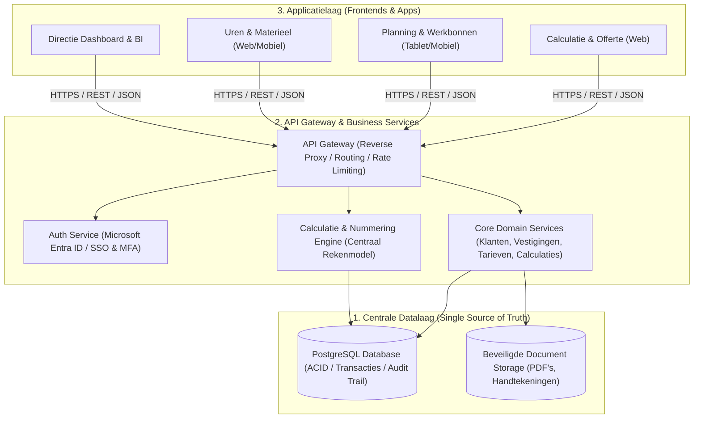
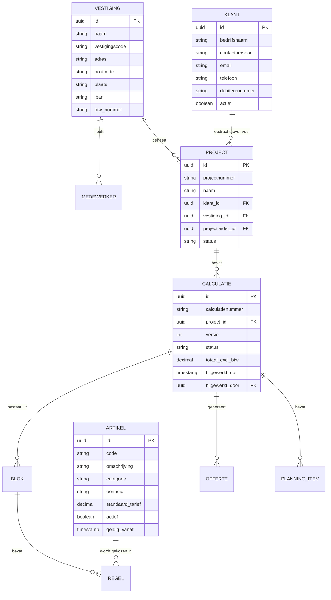
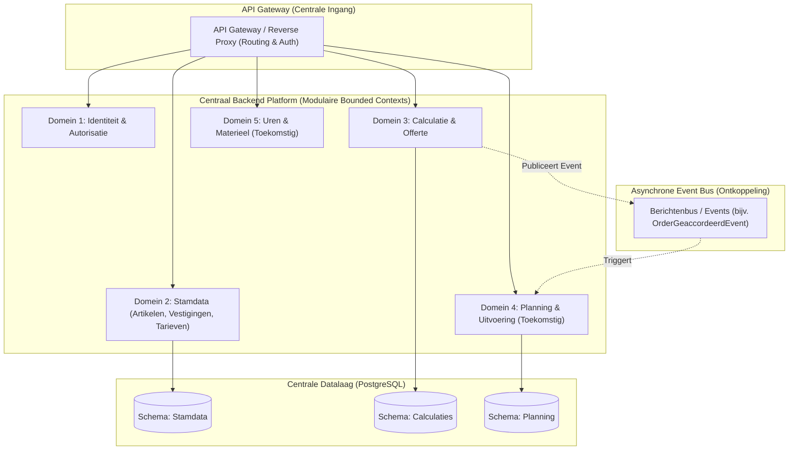
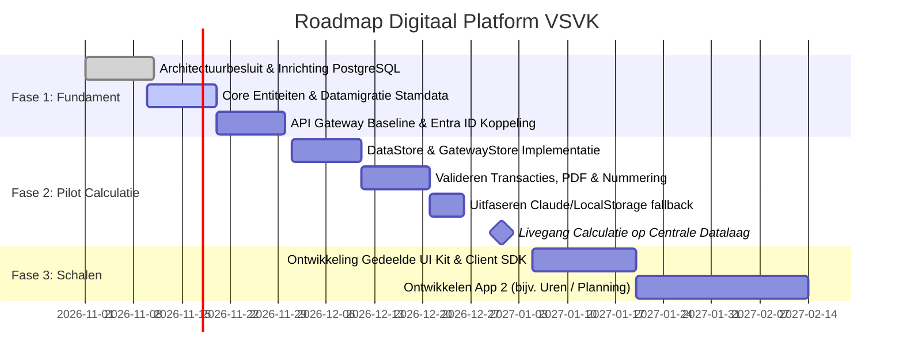

# Strategisch Advies & Doelarchitectuur: VSVK Digitaal Platform

> **Doelgroep:** Directie & Management VSVK  
> **Auteur:** Software Architectuur & Ontwikkeling  
> **Status:** Voorstel t.b.v. besluitvorming  
> **Uitgangspunt:** Transitie van stand-alone calculatie-tool naar een schaalbaar, veilig enterprise applicatielandschap.

---

## 1. Executive Summary

VSVK wil sneller nieuwe applicaties en functionaliteiten kunnen ontwikkelen (zoals calculatie, werkvoorbereiding, planning, urenregistratie, materieelbeheer en directie-dashboards). 

In de huidige situatie is de calculatie-applicatie een stand-alone frontend waarbij data lokaal in browsers of in losse JSON-documenten wordt opgeslagen. Als er op deze manier meer applicaties worden gebouwd, ontstaan **datasilo's**: gegevens over klanten, tarieven, medewerkers en projecten raken gefragmenteerd, wijzigingen moeten op meerdere plekken handmatig worden doorgevoerd, en er ontstaan compliance- en beveiligingsrisico's.

**De oplossing:**  
Een professionele **3-lagen doelarchitectuur** met:
1. **Centrale Datalaag (Single Source of Truth):** Eén robuuste interne database met de kernentiteiten van VSVK.
2. **API Gateway & Business Logic Laag:** De centrale verkeersregelaar die zorgt voor beveiliging, autorisatie, validatie en consistente bedrijfslogica.
3. **Modulaire Applicatielaag:** Frontends (web en mobiel) die snel en goedkoop ontwikkeld kunnen worden omdat ze direct kunnen inhaken op kant-en-klare, beveiligde API-bouwstenen.

---

## 2. De 3-Lagen Architectuur in Detail

### Laag 1: Centrale Datalaag (Core Entiteiten & SSOT)
**Technologieadvies:** **PostgreSQL** (versie 16+)

#### Waarom PostgreSQL?
- **Rotsvaste ACID-garanties:** Essentieel voor financiële calculaties, offertes en unieke nummeruitgifte zonder risico op dubbele nummers of dataverlies bij netwerkstoringen.
- **Hybride kracht (Relationeel + JSONB):** Gestructureerde kernentiteiten (Klant, Vestiging, Artikel) zijn relationeel gemodelleerd; flexibele velden kunnen veilig en geïndexeerd als JSONB worden opgeslagen.
- **Open source & geen vendor lock-in:** Draait probleemloos op eigen hardware (on-premise in het VSVK-datacenter) of in een private cloud omgeving.
- **Rijke tooling:** Uitstekende ondersteuning voor geautomatiseerde migraties, point-in-time herstel en audit-logging.

#### Core Entiteitenmodel
De data wordt ontkoppeld uit losse JSON-blobs naar duidelijke domeinentiteiten:

#### Datakwaliteit & Auditability
- **Onherroepelijke Audit Trail:** Voor calculaties en financiële offertes geldt een audittrail (`created_at`, `created_by`, `updated_at`, `updated_by`).
- **Versiebeheer & Snapshotting:** Wanneer een offerte de status *Verstuurd* of *Opdracht* bereikt, wordt een definitieve snapshot vastgelegd. Wijzigingen in de stamdata (bijv. artikelprijs stijgt volgend jaar) mogen reeds verzonden offertes immers nooit met terugwerkende kracht wijzigen.
- **Soft Deletes:** Records worden niet fysiek verwijderd, maar gemarkeerd als gearchiveerd (`deleted_at IS NOT NULL`).

---

### Laag 2: API Gateway & Business Logic Laag
**Technologieadvies:** **Node.js met TypeScript (bijv. Fastify/NestJS)** of **.NET Core (C#)**

De API Gateway fungeert als het centrale zenuwstelsel. Frontends praten **nooit** rechtstreeks met de database.

#### Kernverantwoordelijkheden:
1. **Centrale Bedrijfs- en Rekenlogica:**
   Calculatieregels, opslagpercentages (AK en W&R), toeslagen en btw-berekeningen worden op de backend berekend of gevalideerd. De frontend toont realtime berekeningen, maar de backend is bindend.
2. **Concurrency-veilige Nummeruitgifte:**
   Nummerreeksen (`2027-001`, `2027-002`) worden via een transactionele databank-sequence of gecontroleerde locking toegekend. Dit voorkomt dat twee calculators gelijktijdig hetzelfde nummer claimen.
3. **Gestandaardiseerde REST / OpenAPI Specificaties:**
   Elk eindpunt is voorzien van een Swagger/OpenAPI-contract. Frontends hebben een strakke interface en weten exact welk datatype verwacht wordt.
4. **Rate Limiting & Threat Protection:**
   Beveiliging tegen abuse, brute force en injectieaanvallen (SQL injection, XSS).

---

### Laag 3: Applicatielaag (Frontends & Snelle Uitbreiding)
**Technologieadvies:** Moderne Web Standards (HTML5 / TypeScript / CSS) of een component-framework met een gedeelde VSVK UI Design Library.

#### Hoe zorgt dit voor "snel applicaties kunnen maken"?
- **Gedeelde `DataStore` SDK:** Elke nieuwe frontend (urenapp, planningstool, calculatie) importeert een kleine interne client-bibliotheek die automatisch authenticatie, foutafhandeling en API-communicatie regelt.
- **Huisstijl & Componenten:** Knoppen, tabellen, modals, formulieren en navigatie worden eenmalig ontworpen volgens de VSVK-standaard.
- **Focus op de business:** Een ontwikkelaar hoeft zich voor een nieuwe app alleen te richten op het scherm en de workflow; de data-opslag, beveiliging en autorisatie zijn al geregeld.

---

## 3. Enterprise Visie op Microservices: De Pragmatische Evolutie

Een veelvoorkomende vraag bij moderniseringstrajecten is: *"Moeten we alles direct opsplitsen in microservices?"*  
Voor een organisatie met de schaal, dynamiek en wensen van VSVK is een **ondoordachte microservices-aanpak een groot risico**.

### 3.1 De Valkuil van Vroegtijdige Microservices
Wanneer elke functie (calculaties, klanten, artikelen, planning) vanaf dag één als een aparte microservice met een eigen database en eigen container wordt gebouwd:
* **Explosie van operationele complexiteit:** Er is direct behoefte aan geavanceerde container-orchestratie (Kubernetes), distributed tracing, complexe netwerkbeveiliging en monitoring van tientallen losse processen.
* **Verlies van transactie-integriteit (ACID):** Zodra een handeling meerdere services raakt (bijvoorbeeld een calculatie die tegelijkertijd planning en budgetten reserveert), vervallen klassieke database-transacties. Er zijn dan complexe "Saga-patronen" en tweefasen-commits nodig, wat vaak leidt tot data-inconsistenties.
* **Tragere ontwikkelsnelheid:** De directie wil juist **snel** nieuwe functionaliteit kunnen uitrollen. Als ontwikkelaars voortdurend netwerkcontracten, deployment-volgordes en API-versies tussen losse services moeten synchroniseren, daalt de productiviteit drastisch.

### 3.2 De Best Practice: De Modulaire Monoliet (Domain-Driven Design)
Voor VSVK adviseren wij een **Modulaire Monoliet** als startpunt en fundament van de enterprise visie:

1. **Eén centrale runtime en database:** Eenvoudig te deployen, beheren en back-uppen.
2. **Strikte logische domeinscheiding (Bounded Contexts):** Binnen de backend worden de domeinen strikt van elkaar gescheiden:
   - *Domein Stamdata & Identiteit* (Artikelen, Tarieven, Vestigingen, Medewerkers)
   - *Domein Calculatie & Offerte* (Calculaties, Blokken, Regels, Offerte-modellen)
   - *Domein Planning & Uitvoering* (Planningsitems, Mijlpalen, Werkbonnen)
   - *Domein Uren & Materieel* (Urenregistratie, Inzet materieel)
3. **Geen ongecontroleerde dwarsverbanden:** Domein A mag uitsluitend communiceren met Domein B via een gedefinieerde service-interface, nooit door rechtstreeks in elkaars databasetabellen te schrijven.

### 3.3 De Evolutionaire Stap: Wanneer wél een Microservice afsplitsen?
Omdat de domeinen al strak zijn gemodelleerd en geïsoleerd, behoudt VSVK de **volledige architectonische flexibiliteit**. Een domein kan op elk gewenst moment worden losgeknipt tot een zelfstandige microservice zodra daar een gegronde technische of operationele reden voor is:

* **Afwijkend schaalprofiel:** Bijvoorbeeld een toekomstige IoT-module die realtime GPS- en sensordata van botsabsorbers en actiewagens verwerkt (duizenden berichten per minuut). Dit hoort technisch thuis in een aparte, lichtgewicht microservice.
* **Onafhankelijke teams of externe partners:** Als een gespecialiseerde externe partij een specifieke app bouwt (bijv. mobiele schouw-app), kan die module als zelfstandige service worden beheerd.
* **Transparant voor de gebruiker:** Omdat de **API Gateway** tussen de frontends en de backends staat, merken de applicaties hier niets van. Het endpoint `/api/v1/calculaties` of `/api/v1/telemetrie` blijft voor de frontends identiek, ongeacht of de logica erachter in de modulaire monoliet of in een losse microservice draait.

### 3.4 Asynchrone Koppeling via Domein-Events
Om domeinen nu alvast losjes te koppelen zonder netwerkvertraging, maken we gebruik van **Domain Events**:
* **Voorbeeld:** Zodra een calculatie in de app de status `Opdracht` krijgt, publiceert het calculatiedomein het event `CalculatieGeaccordeerd`.
* De planningsmodule en de financiële administratie vangen dit event op en voeren hun eigen taken uit (bijv. projectdossier en concept-planning aanmaken), zonder dat de calculatie-app afhankelijk is van de interne logica van die modules.

---

## 4. Security, Authenticatie & Autorisatie

### A. Authenticatie: Microsoft Entra ID (voorheen Azure AD)
VSVK werkt met Microsoft 365.
- **Single Sign-On (SSO):** Medewerkers loggen in met hun bestaande VSVK-account via het **OAuth 2.0 / OpenID Connect (OIDC)** protocol.
- **Multi-Factor Authenticatie (MFA):** Wordt direct geërfd van het centrale Microsoft-beleid. Geen eigen wachtwoorden in de applicatie.
- **Token-based communicatie:** De frontend ontvangt na login een kortlevende JWT (JSON Web Token), die bij elk API-verzoek in de `Authorization: Bearer <token>` header wordt meegestuurd.

### B. Autorisatie: Role-Based Access Control (RBAC) & Vestigingsscheiding
Niet elke medewerker mag overal bij. We richten een matrix in:

| Rol | Rechten | Toelichting |
|---|---|---|
| **Calculator** | CRUD Calculaties & Offertes (eigen vestiging) | Kan geen stamdata (uurtarieven) definitief wijzigen. |
| **Projectleider** | Inzien Calculaties, beheren Planning & Status | Kan calculaties overdragen naar uitvoering. |
| **Vestigingsmanager** | Volledige toegang eigen vestiging (incl. goedkeuringen) | Ziet uitsluitend data van bijv. Pijnacker of Rilland. |
| **Directie / Admin** | Overkoepelend inzicht (alle vestigingen), Stamdata beheer | Kan tarieven, artikelen en bedrijfsbrede instellingen beheren. |

> [!IMPORTANT]
> **Vestigingsscheiding (Data Scoping):** De API Gateway dwingt af dat queries automatisch gefilterd worden op `vestiging_id`, tenzij de gebruiker overkoepelende rechten heeft. Dit voorkomt dat medewerkers onbedoeld calculaties van andere vestigingen overschrijven.

### C. AVG / Privacy & Bescherming van Persoonsgegevens
- **Handtekeningen:** In het huidige prototype zit de handtekening van de directie (`SIG_PVK`) als een ongecodeerde base64-string in de broncode en lokale browser. In de doelarchitectuur worden handtekeningen en identiteitsbewijzen opgeslagen in een **beveiligde private object storage** en uitsluitend on-demand gerenderd door geautoriseerde backend-processen (bij het genereren van een officiële PDF).
- **Encryptie:** 
  - *In transit:* Verplicht TLS 1.3 (HTTPS) voor al het interne en externe verkeer.
  - *At rest:* Database-versleuteling (LUKS / encrypted storage volume).

---

## 5. Non-Functional Requirements (NFR's)

### Performance
- **API Response Tijden:** `< 100 ms` voor reguliere CRUD-operaties; `< 300 ms` voor complexe calculatielijsten.
- **In-Memory Caching:** Stamdata die zelden verandert (artikelen, uurtarieven, vestigingen) wordt in het geheugen gecachet (bijv. Redis of node-cache), zodat niet voor elke regel de database geraadpleegd hoeft te worden.

### Betrouwbaarheid & Back-up (RPO & RTO)
- **RPO (Recovery Point Objective):** Maximaal 1 uur dataverlies. Gerealiseerd door dagelijkse volledige back-ups in combinatie met PostgreSQL WAL-archivering (Write-Ahead Logging / Point-in-Time Recovery).
- **RTO (Recovery Time Objective):** Binnen 2 uur een volledige herstart op alternatieve infrastructuur bij calamiteiten.

### Onderhoudbaarheid & CI/CD
- **Infrastructuur als Code (Docker):** Zowel de database, de API gateway als de webapps draaien in Docker-containers. Dit garandeert dat de ontwikkelomgeving 100% gelijk is aan de productieomgeving.
- **Geautomatiseerde CI/CD Pipeline:** Wijzigingen worden via GitHub Actions automatisch getest (linting, unittests, security checks) voordat ze naar productie worden gedeployed.

---

## 6. Gefaseerd Software Development Traject (Roadmap)

Om het risico minimaal te houden en direct waarde te leveren, adviseren we een **3-fasen aanpak**. We bouwen niet maanden aan een "black box", maar migreren de bestaande calculatie-app stap voor stap als pilot.

### Fase 1: Het Fundament (Datalaag & API Gateway)
- Inrichten interne PostgreSQL database (containerized).
- Datamigratie van de huidige stamdata (de 77 artikelen, tarieven, 3 vestigingen, medewerkers en offerteteksten).
- Basis API Gateway opzetten met Microsoft Entra ID (SSO) en endpoints voor stamdata.

### Fase 2: Pilot — Calculatie-applicatie Aansluiten
- In `apps/calculatie/index.html` de opslag-naad ontkoppelen (zie `docs/storage-seam.md`): vervangen van de ad-hoc `localStorage`- en Claude-code door een robuuste `GatewayStore`.
- Concurrency-veilige nummeruitgifte live testen.
- Officiële PDF-generatie valideren en handtekeningen beveiligen.
- **Resultaat na Fase 2:** De eerste volwaardige enterprise webapplicatie draait live op de nieuwe centrale datalaag!

### Fase 3: Het Ecosysteem Schalen (Nieuwe Functionaliteit)
- Opleveren van de herbruikbare VSVK Frontend SDK.
- Start van volgende functionaliteiten (bijvoorbeeld: Planning & Werkbonnen voor de buitendienst, of Urenregistratie gekoppeld aan de calculatieblokken).

---

## 7. Gespreksagenda voor het Directieoverleg

Gebruik onderstaande punten als kapstok voor het overleg met de directie:

### A. De Strategische Keuze (Waarom nu?)
* **Snelheid vs. Chaos:** Uitleggen dat snel applicaties bouwen *alleen* duurzaam kan als het fundament (één centrale bron van waarheid) goed staat. Zonder dit fundament resulteert elke nieuwe app in dubbele data en administratieve fouten.
* **Beheersbaarheid:** Prijswijzigingen in artikelen of tarieven hoeven straks maar op **één plek** te worden aangepast en gelden direct voor alle vestigingen en toekomstige apps.
* **Pragmatische architectuur:** We kiezen niet voor een modieus, complex doolhof van 20 losse microservices, maar voor een **Modulaire Monoliet**. Dit geeft maximale ontwikkelsnelheid nu, met behoud van de flexibiliteit om later onderdelen los te trekken.

### B. Beslispunten voor de Directie
1. **Hostinglocatie van het platform:**  
   *Optie 1 (Aanbevolen):* Private Cloud (bijv. Microsoft Azure in de regio Nederland/West-Europa, naadloos aansluitend op Microsoft 365).  
   *Optie 2:* On-premise server op het hoofdkantoor in Pijnacker (met VPN-verbindingen vanuit Rilland en Wamel).
2. **Authenticatiebeleid:**  
   Akkoord geven op het gebruik van de bestaande Microsoft 365 / Entra ID accounts als centrale login voor alle bedrijfssoftware.
3. **Prioritering van de Roadmap:**  
   Akkoord op Fase 1 & 2 (Calculatie als succesvolle pilot), en vaststellen welke bedrijfsfunctie als tweede app prioriteit heeft (bijv. Werkbonnen/Buitendienst of Uren).

### C. Return on Investment (ROI)
* **Lagere ontwikkelkosten:** Na oplevering van de API Gateway en het datamodel daalt de bouwtijd van vervolgschermen en -apps met **50% tot 70%**, omdat dataontsluiting en authenticatie al gereed zijn.
* **Geen data-verlies:** Elimineert het risico dat calculaties kwijtraken bij een browser-opschoning of computerwissel.
* **Foutreductie:** Calculators en projectleiders werken altijd met de actuele, door de directie geaccordeerde uurtarieven en marges.

