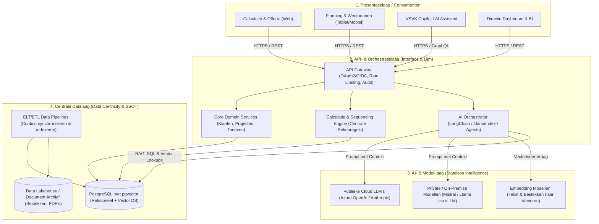
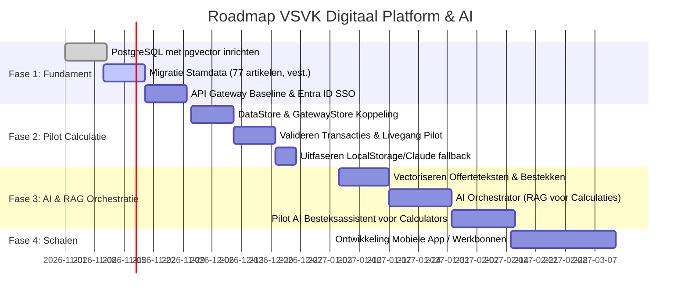

# Strategisch Advies & Doelarchitectuur: VSVK Digitaal Platform
## API-First & Data-Centric AI Architectuur

> **Doelgroep:** Directie & Management VSVK  
> **Auteur:** Software & AI Architectuur  
> **Status:** Voorstel t.b.v. besluitvorming  
> **Uitgangspunt:** Transitie van stand-alone prototype naar een schaalbaar, veilig, API-first en AI-gereed enterprise platform.

---

## 1. Executive Summary

VSVK wil sneller nieuwe applicaties en functionaliteiten ontwikkelen (o.a. calculatie, werkvoorbereiding, planning, urenregistratie, materieelbeheer en directie-dashboards), en tevens de kracht van **moderne AI** (zoals geautomatiseerde besteksanalyse, slimme calculatiesuggesties en offerte-generatie) kunnen benutten.

In de huidige situatie is de calculatie-applicatie een stand-alone frontend waarbij data lokaal in browsers of in losse JSON-documenten wordt opgeslagen. Als hierop voortgebouwd wordt, ontstaan **datasilo's** en is betrouwbare AI onmogelijk: AI-modellen hebben immers een betrouwbare, actuele en centrale databron nodig om te voorkomen dat ze 'hallucineren' of verouderde tarieven hanteren.

### De Oplossing: Een 4-Lagen API-First & Data-Centric AI Architectuur
In deze doelarchitectuur zijn **data**, **AI-logica**, **orkestratie** en de **presentatielaag** strikt van elkaar ontkoppeld. Dit garandeert maximale schaalbaarheid, veiligheid en flexibiliteit.

```
+-------------------------------------------------------------+
| 1. Presentatielaag / Consumenten (Web, Mobiel, IoT, AI-Chat)|
+-------------------------------------------------------------+
              ▲ REST / GraphQL / gRPC ▼
+-------------------------------------------------------------+
| 2. API- & Orchestratielaag (Gateway, LangChain, Agents)     |
+-------------------------------------------------------------+
              ▲ Aanroepen AI / Data queries ▼
+-------------------------------------------------------------+
| 3. AI- & Model-laag (LLM's, Embedding-modellen, Regels)     |
+-------------------------------------------------------------+
              ▲ Vector- en Metadata-lookups ▼
+-------------------------------------------------------------+
| 4. Centrale Datalaag (Data Lakehouse, Vector DB, RDBMS)     |
+-------------------------------------------------------------+
```



---

## 2. De 4 Kernlagen in Detail

### Laag 4: Centrale Datalaag (Data Centricity & Single Source of Truth)
Data wordt niet lokaal in applicaties opgeslagen, maar gecentraliseerd en gestructureerd voor zowel transactioneel gebruik als AI-consumptie.

1. **Hybride Database: PostgreSQL met `pgvector`**
   * **Waarom deze keuze?** In plaats van een aparte losse vector-database (zoals Pinecone of Milvus) naast een relationele database, biedt PostgreSQL met de `pgvector`-extensie het beste van twee werelden binnen één betrouwbare datastore.
   * **Gestructureerde bedrijfsdata:** Klanten, vestigingen, artikelen, uurtarieven, offertes en calculaties worden relationeel met strikte ACID-transacties bewaard.
   * **Vector Data (Embeddings):** Ongestructureerde data (eerdere offertes, standaardteksten, bestekken, RAW-bepalingen, schouwrapporten) wordt omgezet in wiskundige vectoren en direct in PostgreSQL opgeslagen en doorzocht met cosine-similarity.
2. **Centraal Document- & Data-archief:**
   * Veilige opslag voor officiële PDF's, getekende overeenkomsten, foto's van situaties en handtekeningen.
3. **Data Pipeline (ELT/ETL):**
   * Geautomatiseerde processen die nieuwe data (bijv. nieuw ingevoerde artikelen of geaccepteerde offertes) automatisch schonen, valideren en vectoriseren zodat de AI altijd beschikt over up-to-date context.

---

### Laag 3: AI- & Model-laag (Stateless Intelligence)
Deze laag verwerkt de AI-logica **zonder zelf data permanent op te slaan**. Dit garandeert dat bedrijfsdata nooit 'lekt' naar het model.

1. **Model-Flexibiliteit (Geen Vendor Lock-in):**
   * De architectuur is model-agnostisch. VSVK kan flexibel schakelen tussen:
     * **Enterprise Cloud API's:** Bijvoorbeeld Microsoft Azure OpenAI (GPT-4o) of Anthropic Claude onder strikte zakelijke verwerkersovereenkomsten (waarbij Microsoft/OpenAI garandeert dat data *niet* wordt gebruikt om modellen te trainen).
     * **On-Premise / Lokale Modellen:** Opensource modellen (zoals Mistral of Llama 3) draaiend in eigen beheer (via vLLM of Hugging Face) voor 100% data-soevereiniteit.
   * *Voordeel:* Komt er morgen een sneller, goedkoper of slimmer model uit? Dan wordt uitsluitend de adapter in deze laag vervangen; de frontends en de database merken hier niets van.
2. **Embedding Models:**
   * Snelle, gespecialiseerde modellen die binnenkomende bestekken of zoekvragen van calculators in milliseconden omzetten in vectoren om de centrale database semantisch te doorzoeken.

---

### Laag 3 (Detail): Hoe AI concreet werkt voor VSVK via RAG
In plaats van AI direct antwoorden te laten 'verzinnen', passen we het **Retrieval-Augmented Generation (RAG)** patroon toe:

```
[ Calculator typt: "Maak calculatie voor vervangen 200 LED-armaturen in Noordtunnel" ]
                                  │
                                  ▼
                    [ 2. AI Orchestrator (LangChain) ]
                                  │
          ┌───────────────────────┴───────────────────────┐
          │ 1. Vector Search                              │ 2. SQL Query
          ▼                                               ▼
[ Zoek relevante bestekbepalingen ]              [ Haal actuele uurtarieven op: ]
[ en uitgangspunten in pgvector   ]              [ Monteur E&M (€62,70),       ]
          │                                      [ Hoogwerker (€38,59), etc.   ]
          └───────────────────────┬───────────────────────┘
                                  │
                                  ▼
[ Verrijkte Prompt naar LLM: "Gebruik UITSLUITEND deze data om de regels op te bouwen" ]
                                  │
                                  ▼
[ Gestructureerde JSON Calculatieregels terug naar API Gateway -> Direct in de UI ]
```

> [!IMPORTANT]
> **Geen Hallucinaties:** Het AI-model berekent geen tarieven uit het hoofd. De orchestrator haalt eerst de **gevalideerde stamdata** (de 77 officiële VSVK-artikelen) op uit PostgreSQL. Het AI-model structureert en matcht de tekst uitsluitend op basis van de feiten.

---

### Laag 2: API- & Orchestratielaag (De Interface & Lijm)
Ontworpen volgens het **API-First principe**: de API is het primaire product; applicaties zijn slechts consumenten.

1. **API Gateway:**
   * Centrale toegangspoort voor alle frontends.
   * Regelt authenticatie via **Microsoft Entra ID (OAuth2/OIDC)**, centrale rate limiting, IP-filtering en audit logging.
2. **API Interfaces (Standaarden):**
   * **REST met OpenAPI (Swagger):** Voor alle standaard CRUD-operaties (klanten, calculaties, uren, planning).
   * **GraphQL / WebSockets:** Voor realtime AI-streaming (bijv. realtime gegenereerde calculatiesuggesties of chat-antwoorden) en live dashboard-statistieken.
3. **AI Orchestrator (bijv. LangChain of LlamaIndex):**
   * Vangt de vraag op vanuit de frontend.
   * Voert de semantische zoekopdracht uit in `pgvector`.
   * Stelt de 'verrijkte prompt' samen met bedrijfsspecifieke context en veiligheidsregels.
   * Valideert de AI-output tegen een strikt JSON-schema voordat deze naar de frontend wordt gestuurd.
4. **Centrale Bedrijfs- en Rekenregels:**
   * Zorgt dat opslagpercentages (AK en W&R), toeslagen en unieke nummeruitgifte (`2027-001`) server-side worden gevalideerd en vastgelegd.

---

### Laag 1: Presentatielaag / Consumenten (Front-end)
De applicatielaag bevat **geen database- en geen AI-logica**. Frontends zijn lichte, snelle en veilige interfaces:

* **Consumenten:**
  * Webapplicatie: Calculatie & Offerte (de huidige tool omgebouwd tot API-client).
  * Mobiel / Tablet: Buitendienst-app voor monteurs en uitvoerders (schouwingen, werkbonnen, uren).
  * AI Copilot: Een chat- of assistenten-interface voor werkvoorbereiders.
  * Directie Dashboard: Realtime BI en managementrapportages.
* **Voordeel van de ontkoppeling:**
  Wil VSVK volgend jaar een mobiele app lanceren voor verkeersregelaars of een spraakgestuurde invoer op de bouwplaats? Dan kan die direct aansluiten op de bestaande API Gateway zonder aanpassingen aan de database of AI-modellen.

---

## 3. Enterprise Visie: Modulaire Monoliet vs. Microservices

Hoe verhoudt de wens voor microservices zich tot deze AI-first architectuur?

### De Valkuil: Vroegtijdige Microservices
Het direct opknippen in 15-20 losse microservices leidt bij de huidige schaal van VSVK tot:
* Enorme operationele overhead (Kubernetes, distributed tracing, netwerk-latency).
* Moeizame dataverzameling voor AI: als data verspreid is over 10 databases, is RAG (Retrieval-Augmented Generation) traag en complex.
* Verlies van ACID-transacties bij financiële nummeruitgifte en offertestatus.

### Het Advies: Modulaire Monoliet met Bounded Contexts
We bouwen de API- en datalaag als een **Modulaire Monoliet** met strikte domeinscheiding (Domain-Driven Design):
1. **Domein Stamdata & Identiteit:** Klanten, Vestigingen, Artikelen, Uurtarieven.
2. **Domein Calculatie & Offerte:** Calculatieblokken, Rekenregels, Offertes, Snapshotting.
3. **Domein AI & Knowledge:** Vector-indexen, Besteksanalyse, Prompt-sjablonen.
4. **Domein Planning & Uitvoering (Toekomstig):** Mijlpalen, Werkbonnen, Uitvoering.

**Evolutionair pad:** Zodra een module (bijvoorbeeld de AI-orkestratie of realtime telemetrie van actiewagens) een afwijkend schaalprofiel krijgt of door een ander team wordt beheerd, kan deze **zonder herontwerp** worden losgeknipt tot een zelfstandige microservice. De API Gateway zorgt ervoor dat de frontends hier niets van merken.

---

## 4. Security, Governance & AVG bij AI-gebruik

Het toevoegen van AI aan een bedrijfsarchitectuur stelt specifieke eisen aan security:

1. **Geen Training op VSVK-Data:**
   Bij gebruik van publieke cloud LLM's (zoals Azure OpenAI) worden expliciete zakelijke voorwaarden contractueel vastgelegd: prompts en bedrijfsgegevens worden **nooit** gebruikt om publieke modellen te trainen.
2. **Data Scoping & Vestigingssegregatie vóór AI-aanroep:**
   De API Gateway past *vóórdat* context naar het AI-model wordt gestuurd al de rol- en vestigingsfilters toe. Een calculator in Rilland krijgt via de AI uitsluitend data en bestekken te zien die geautoriseerd zijn voor vestiging Rilland.
3. **AVG / Privacybescherming:**
   Persoonsgegevens (zoals handtekeningen, personeelsdossiers of BSN-nummers) worden door de Data Pipeline geanonimiseerd of gefilterd voordat ze in de vector-database belanden.
4. **Centrale Entra ID (M365) Login:**
   Toegang tot zowel de webapps als de AI-mogelijkheden verloopt via Single Sign-On (SSO) en verplichte Multi-Factor Authenticatie (MFA).

---

## 5. Non-Functional Requirements (NFR's)

| NFR | Doelstelling & Inrichting |
|---|---|
| **API Responstijd (Standaard)** | `< 100 ms` voor reguliere CRUD-operaties op PostgreSQL. |
| **AI Responstijd (Streaming)** | Eerste token binnen `< 800 ms` via server-sent events (SSE) of WebSockets. |
| **Vector Search Latency** | `< 50 ms` voor semantische lookups via geïndexeerde HNSW/IVFFlat indexen in `pgvector`. |
| **Data Integriteit** | 100% ACID-transacties bij nummeruitgifte en statuswijzigingen (`Concept` &rarr; `Verstuurd` &rarr; `Opdracht`). |
| **Back-up & Herstel** | Dagelijkse geautomatiseerde snapshots + PostgreSQL WAL-archivering. RPO `< 1 uur`, RTO `< 2 uur`. |
| **Infrastructuur** | Volledig containerized via Docker; geautomatiseerde CI/CD via GitHub Actions. |

---

## 6. Gefaseerde Roadmap (Inclusief AI-Integratie)



1. **Fase 1: Fundament (Weken 1-4)**  
   Centrale PostgreSQL datalaag met `pgvector` opzetten; stamdata migreren; API Gateway met Entra ID inrichten.
2. **Fase 2: Pilot Calculatie Live (Weken 5-7)**  
   Huidige calculatietool via `GatewayStore` koppelen aan de API Gateway; unieke nummering live brengen. Eerste enterprise app live!
3. **Fase 3: AI Orchestratie & RAG Pilot (Weken 8-11)**  
   Vectoriseren van historische calculaties en standaardteksten; toevoegen van de AI Orchestrator (LangChain/LlamaIndex) die calculators helpt bestekken te koppelen aan de juiste VSVK-artikelen.
4. **Fase 4: Ecosysteem Uitbreiden (Week 12+)**  
   Bouw van vervolgapplicaties (planning, buitendienst werkbonnen, urenregistratie) met 60% kortere ontwikkeltijd.

---

## 7. Gespreksagenda voor het Directieoverleg

### A. De Strategische Keuze: Waarom API-First & Data-Centric AI?
* **Voorkom desinvesteringen:** Veel bedrijven bouwen eerst losse apps en proberen er later AI "aan vast te plakken". Door nú te kiezen voor een ontkoppelde 4-lagen architectuur, is elke applicatie die we bouwen vanaf dag één AI-gereed.
* **Geen hallucinaties:** Dankzij RAG (Retrieval-Augmented Generation) put de AI altijd uit de actuele, gevalideerde uurtarieven van VSVK.
* **Model-onafhankelijkheid:** We worden niet gegijzeld door één AI-leverancier. We kunnen vandaag Azure OpenAI gebruiken en morgen een lokaal open-source model zonder dat onze software verbouwd hoeft te worden.

### B. Beslispunten voor de Directie
1. **Hostinglocatie van het platform:**  
   *Aanbeveling:* Private Cloud (Microsoft Azure NL) naadloos aangesloten op Microsoft 365 en Azure OpenAI (met enterprise data-bescherming).
2. **Datalaag met AI-capaciteit:**  
   Akkoord op PostgreSQL met `pgvector` als centrale interne bron van waarheid voor zowel financiële data als documentvectoren.
3. **AI Governance Beleid:**  
   Vaststellen dat bedrijfsdata nooit mag worden gebruikt voor openbare modeltraining, en dat AI-suggesties altijd door een mens (calculator) worden goedgekeurd vóór verzending van de offerte.

### C. Return on Investment (ROI)
* **Tijdwinst Calculatie:** Besteksanalyse en het opzetten van calculatieblokken gaat van uren handwerk naar minuten met AI-assistentie.
* **Bouwtijd Volgende Apps:** Ontwikkelsnelheid voor nieuwe schermen en functionaliteiten stijgt met 60%.
* **Foutreductie & Kwaliteit:** Gegarandeerd correcte uurtarieven en marges, consistente offerteteksten en volledige audit-traceerbaarheid.
