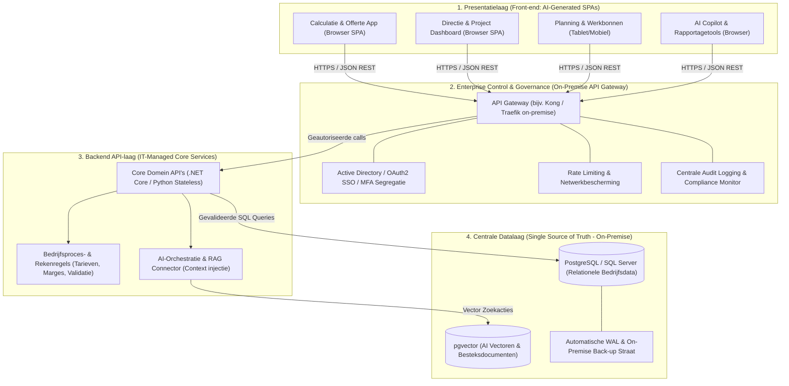
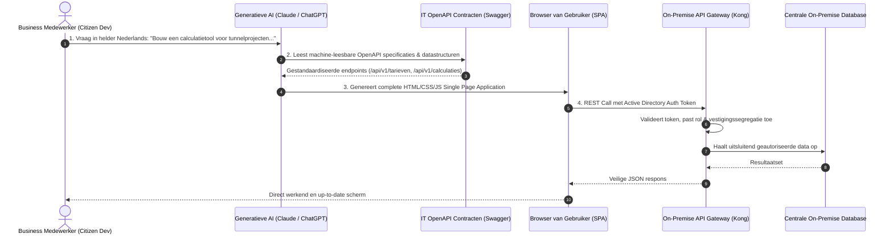

# Management Samenvatting: De Toekomstbestendige On-Premise Applicatiearchitectuur via AI-Driven Development

> **Documenttype:** Strategische Directievisie & IT-Architectuur  
> **Status:** Definitief Voorstel voor Directieoverleg  
> **Auteur:** IT & AI Architectuur VSVK  
> **Context:** Transitie naar AI-Driven Citizen Development met 100% On-Premise Data Soevereiniteit  

---

## 1. Het Strategische Doel

Het bouwen van een moderne, flexibele applicatie-infrastructuur waarbij **bedrijfsdata centraal en veilig on-premise blijft**, terwijl de **business de slagkracht krijgt om zelfstandig applicaties te bouwen** met behulp van Generatieve AI (zoals Claude en ChatGPT).

> **Het leidende principe:**  
> **IT bouwt niet langer de losse apps, maar levert de veilige snelweg (gestandaardiseerde API's en centrale databronnen) waar de organisatie gebruik van maakt.**

---

## 2. De 4 Kernlagen van de Doelarchitectuur

Om maximale flexibiliteit, controle en veiligheid te garanderen, is de architectuur strikt opgeknipt in vier onafhankelijke lagen:

### 1. De Presentatielaag (Front-end)
Moderne, op zichzelf staande applicaties (*Single Page Applications* / SPAs) die volledig in de browser van de gebruiker draaien.
* Bevatten **geen datalogica**, geen rechtstreekse databaseverbindingen en **geen harde beveiligingssleutels**.
* Communiceren uitsluitend via beveiligde, kortlevende tokens met de centrale API Gateway.
* Kunnen in recordtijd worden gegenereerd door medewerkers via AI-assistenten (Claude/ChatGPT).

### 2. De Enterprise Control & Governance Laag (API Gateway)
De on-premise "digitale vestingmuur" (bijvoorbeeld **Kong** of **Traefik**):
* Controleert elke inkomende aanvraag op identiteit en rechten via **Active Directory / Entra ID SSO & MFA**.
* Past strikte **vestigingssegregatie** toe (data tussen Pijnacker, Rilland en Wamel blijft gescheiden).
* Beschermt het interne netwerk tegen overbelasting via **rate limiting**.
* Houdt een centrale, onveranderbare **audit log** bij van alle gegevensopvragingen.

### 3. De Backend API-laag (IT-Managed)
Een toestandsloze (*stateless*) programmadans (in **.NET Core** of **Python**):
* Bewaakt centrale bedrijfsprocessen, berekeningsregels, marges en unieke nummerreeksen.
* Vertaalt generieke frontend-vragen naar veilige, geoptimaliseerde database-opdrachten.
* Voorkomt dat bedrijfsregels versnipperd raken over losse applicaties.

### 4. De Centrale Datalaag (Single Source of Truth)
Eén centrale, robuuste on-premise database (zoals **PostgreSQL** met `pgvector` of **SQL Server**):
* Slaat zowel reguliere relationele bedrijfsdata (klanten, projecten, artikelen, uurtarieven) als AI-datastructuren (vectoren van RAW-bestekken en eerdere offertes) centraal en soeverein op.
* Fysiek gehuisvest op eigen servers: back-ups en databeheer blijven volledig in eigen hand.

---

## 3. De Strategische Doorbraak: Citizen Development via AI

Traditionele app-ontwikkeling leidt vaak tot lange IT-wachtlijsten of onveilige wildgroei aan spreadsheets en externe tools (*Shadow IT*). Deze architectuur lost dat fundamenteel op door **AI-Driven Citizen Development** te faciliteren:

### A. Natuurlijke Taal als Programmeertaal
Niet-technische medewerkers omschrijven in helder Nederlands wat voor app ze nodig hebben (bijvoorbeeld een calculatietool, werkvoorbereidingsscherm of directiedashboard). Claude of ChatGPT genereert vervolgens direct de complete code voor de applicatie.

### B. API-Contracten als Onwrikbare Blauwdruk
IT stelt gestandaardiseerde, machine-leesbare API-handleidingen (**OpenAPI / Swagger specificaties**) beschikbaar. De AI leest deze handleidingen en bouwt de applicatie exact volgens de technische specificaties en visuele richtlijnen van het bedrijf. De AI kan nooit datavelden benaderen die IT niet vooraf heeft gedefinieerd.

---

## 4. Waarom de Directie voor deze Koers Moet Kiezen (De Voordelen)

| Pijler | Betekenis voor VSVK | Directievoordeel |
| :--- | :--- | :--- |
| **1. 100% Data Soevereiniteit** | Alle data blijft fysiek binnen de eigen muren en op eigen on-premise servers. | Geen datalekken, volledige naleving van AVG/GDPR en maximale bescherming van calculatiemarges en intellectueel eigendom. |
| **2. Zero-Trust Beveiliging** | Alle AI-apps communiceren verplicht via de centrale API Gateway met Active Directory authenticatie. | Medewerkers kunnen nooit data inzien waar zij op basis van hun rol geen recht op hebben. Volledige controle voor IT. |
| **3. Extreme Innovatiesnelheid** | De business bouwt binnen enkele uren specifieke tools die processen versnellen. | IT verschuift van remmende 'schermenbouwer' naar strategische 'data-enabler'. Geen lange wachttijden meer. |
| **4. Geen Vendor Lock-in** | Volledig modulair en cloud-agnostisch opgebouwd op basis van open standaarden (REST, OpenAPI, SQL). | Toekomstbestendig: wisselen van AI-modellen, databases of gateways kan zonder de applicatielaag te raken. |

---

## 5. Strategische Vergelijking

| Criterium | Traditionele IT-Ontwikkeling | On-Premise AI-Driven Development |
| :--- | :--- | :--- |
| **Doorlooptijd nieuwe applicatie** | 3 tot 9 maanden | **Enkele uren tot 2 dagen** |
| **Dataopslag & Soevereiniteit** | Verspreid over clouds en lokale pc's | **100% On-Premise (Single Source of Truth)** |
| **Rol van de IT-afdeling** | Bouwer van elk formulier (bottleneck) | **Beheerder van veilige API's en datalaag** |
| **Shadow IT Risico** | Hoog (ongecontroleerde tools & spreadsheets) | **0% (ontwikkeling binnen gecontroleerd IT-kader)** |
| **Kosten per nieuwe applicatie** | € 25.000 – € 100.000 per maatwerk app | **Marginaal (AI-generatie op bestaande API's)** |
| **Security & Autorisatie** | Per app verschillend en foutgevoelig | **Centraal afgedwongen op de API Gateway** |

---

## 6. Besluitvorming voor het Directieoverleg

1. **Besluit 1: Goedkeuring On-Premise API Gateway**  
   Inrichten van Kong of Traefik op de interne infrastructuur als centrale beveiligingsschil met Active Directory koppeling.
2. **Besluit 2: Standaardisatie op OpenAPI Contracten**  
   Vastleggen dat alle toekomstige backend-services verplicht via machine-leesbare OpenAPI v3 specificaties worden ontsloten.
3. **Besluit 3: Start Citizen Development Pilot met Calculatie**  
   De huidige calculatie- en offerteapplicatie formaliseren als eerste pilot binnen deze 4-lagen architectuur en de werkwijze uitrollen naar werkvoorbereiding en planning.

